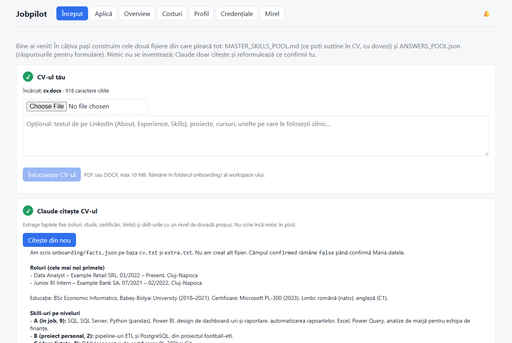
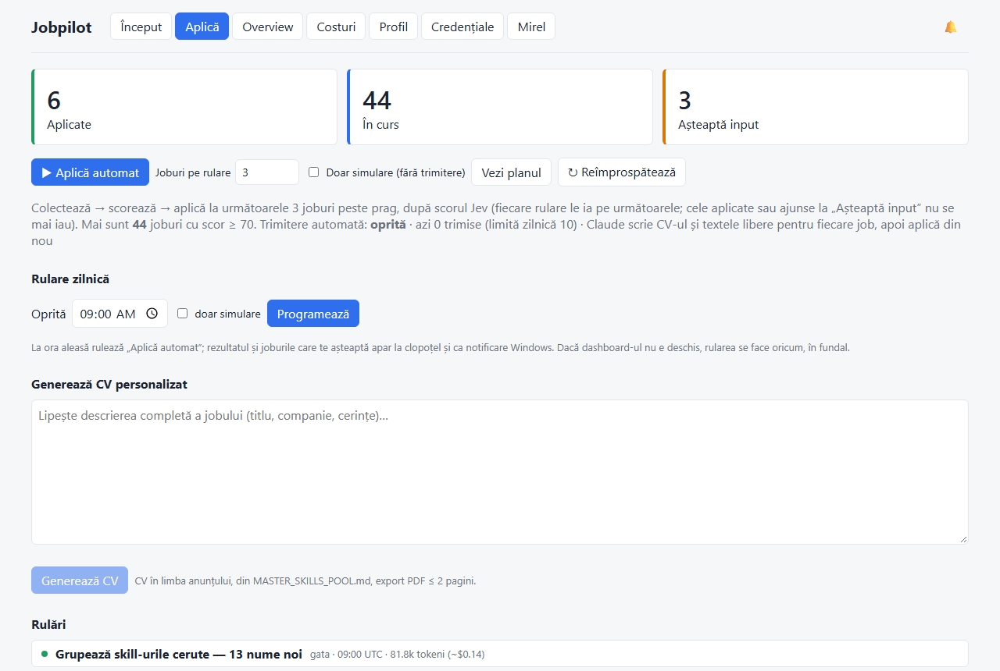
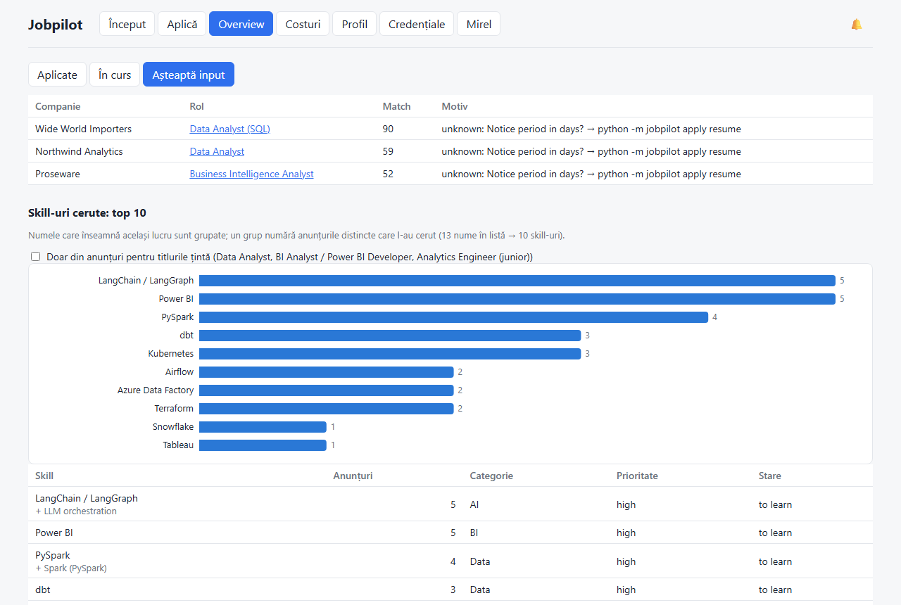
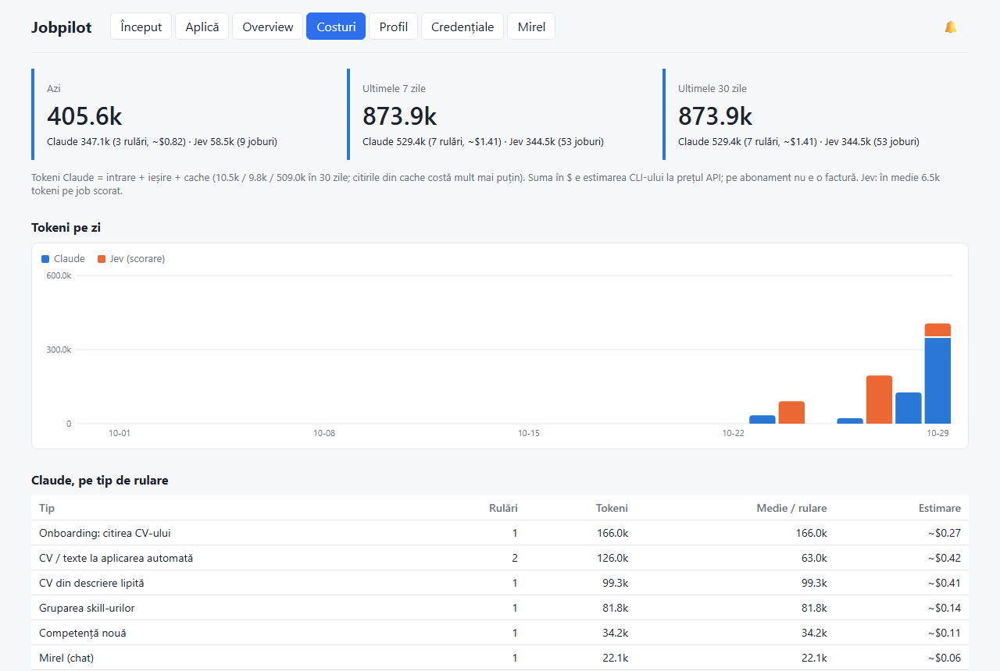

# CV Assistant + Jobpilot

[](https://github.com/AlexNegulescu111/cv-assistant/actions/workflows/tests.yml)
[](LICENSE)

Asistent pentru căutarea unui job, care transformă experiența ta reală în CV-uri adaptate fiecărui anunț (compatibile ATS, ușor de susținut la interviu) și aplică pentru tine pe joburile care ți se potrivesc, fără să inventeze nimic.

- **CV Assistant**: 7 skill-uri (`SKILL.md`) pentru **Claude Code**, **Claude.ai**, **ChatGPT** și **Codex**: onboarding, master pool de competențe cu niveluri de dovadă A–E, CV DOCX/PDF per anunț, răspunsuri reutilizabile pentru formulare, caiet de aplicări.
- **Jobpilot** (local, Windows): colectează zilnic joburi din board-uri publice (Greenhouse, Lever, Ashby, peviitor.ro), le scorează față de profilul tău, completează formularele și aplică la cele mai bune, într-un dashboard local. CAPTCHA-urile, conturile și întrebările noi rămân la tine.

> **In English:** an honest job-search assistant. Skills for Claude / ChatGPT / Codex turn your real experience (an evidence-graded skills pool) into a tailored CV for every job ad, and a local Windows dashboard collects jobs from public ATS boards, scores them, fills the application forms and applies to the best matches - never inventing employers, titles or numbers, and leaving CAPTCHAs, accounts and new questions to you. The interface and docs are in Romanian; CVs follow the language of each ad.

| Onboarding din CV | Aplicare automată |
|---|---|
|  |  |
| **Skill-urile cerute de piață** | **Costuri în tokeni** |
|  |  |

## Start rapid (dashboard-ul local, Windows)

```
git clone https://github.com/AlexNegulescu111/cv-assistant.git
pip install -e "./cv-assistant[dashboard,browser,cv]"
python -m playwright install chromium
jobpilot init --workspace "D:\Aplicari" --open
```

`jobpilot init` creează folderul tău de date (workspace) și îți spune ce mai lipsește. Apoi pagina se deschide pe tab-ul **Început**: încarci CV-ul, confirmi ce a înțeles asistentul, răspunzi la câteva întrebări și primești `MASTER_SKILLS_POOL.md` și `ANSWERS_POOL.json`, din care pleacă tot restul. Ai nevoie de [Claude Code](https://claude.com/claude-code) autentificat, iar pentru scorarea joburilor de o cheie [TypeSafe](https://console.typesafe.ai/keys). Trimiterea automată e oprită până o pornești tu.

Doar skill-urile, fără dashboard (Claude.ai, ChatGPT, Codex): vezi [Instalare](#instalare).

## Ce face

| Skill | Când pornește | Ce produce |
|---|---|---|
| `setup-profile` | prima utilizare: încarci CV-ul, textul de pe LinkedIn și o descriere liberă | mesaj de bun venit, întrebări de verificare, `profile.json`, `MASTER_SKILLS_POOL.md` cu niveluri A–E, `AGENTS.md`, caiet |
| `cv-for-job` | lipești un anunț de job **sau dai linkul** anunțului sau al formularului | analiză de potrivire, CV DOCX + PDF (EN/RO), plan de studiu, întrebări de interviu, caiet actualizat; raportul are o structură fixă. **Cu link:** citește descrierea și formularul, apoi precompletează formularul cu CV-ul atașat; Submit îl apeși tu |
| `add-competency` | ai învățat sau ai construit ceva nou, ai o metrică nouă | pool actualizat, cu verificare că poți susține afirmația la interviu |
| `add-answer` | o întrebare din formular a rămas fără răspuns, „de acum salariul e…”, „răspunde mereu…” | răspuns reutilizabil în `ANSWERS_POOL.json` (pornește din `templates/ANSWERS_POOL.template.json`), verificat cu `scripts/check_answers.py` pe cazurile din `answers_tests.json` |
| `apply-to-job` | dai linkul unui job și vrei să aplici | formularul completat din `ANSWERS_POOL.json`, textele libere scrise din draft, CV-ul atașat; Submit automat doar cu `settings.auto_submit = true`, altfel îl apeși tu; aplicarea în `applied.csv` (cere `jobpilot` + Playwright, deci Claude Code / Codex) |
| `auto-apply` | „aplică automat”, „ce am de rezolvat?” | aplicare pe joburile colectate cu verdict `apply`, primele `top_n` după scorul Jev (`apply.json`; plafon zilnic opțional, `daily_cap`); CAPTCHA, conturile și întrebările noi rămân în coada `needs_human` |
| `job-tracker` | „notează…”, „ce am de făcut?”, „am trimis CV-ul…”, `caiet_changes.json` | notițe cu deadline, statusul aplicărilor, skill-urile cerute pe piață, pagina **Caiet Aplicări** |

**Principiul de bază: maxim onest.** Asistentul reformulează și prioritizează experiența reală, dar nu inventează angajatori, diplome sau cifre.

### Caietul de aplicări (artifactul)
`tracker/caiet.html` e o pagină interactivă generată din CSV-uri: agenda pe deadline-uri, filtre, formular de notițe, skill-urile cerute cu butonul „Planifică” și aplicările cu status. Se deschide în orice browser, inclusiv offline. Ce modifici pe pagină ajunge înapoi în fișiere prin butonul **Descarcă modificările** (`caiet_changes.json`), pe care îl dai asistentului. În Claude poate fi publicat ca artifact.

## Structura pachetului

```
cv-assistant/
  skills/                      ← sursa unică (format SKILL.md, Agent Skills)
    setup-profile/   SKILL.md, agents/openai.yaml, templates/ (profil, master pool, AGENTS.md, CSV)
    cv-for-job/      SKILL.md, agents/openai.yaml, scripts/render_cv.py, scripts/job_page.py (→ jobpilot), templates/cv_draft.template.md
    add-competency/  SKILL.md, agents/openai.yaml
    add-answer/      SKILL.md, agents/openai.yaml, scripts/check_answers.py, templates/ANSWERS_POOL.template.json
    apply-to-job/    SKILL.md, agents/openai.yaml (→ jobpilot page / answers)
    auto-apply/      SKILL.md, agents/openai.yaml (→ jobpilot apply)
    job-tracker/     SKILL.md, agents/openai.yaml, scripts/tracker.py, templates/caiet.html
  chatgpt/  GPT_INSTRUCTIONS.md, SETUP_CHATGPT.md, knowledge/ (generat)
  codex/    SETUP_CODEX.md
  tests/    PARITY_TEST.md, sample_job_ad.md, fixture_workspace/ (profil fictiv)
  examples/ draft de CV fictiv
  tools/    install.py (Codex / Claude Code), build_bundles.py
  jobpilot/ pachetul Python comun: collect (joburi din ATS publice), score (Jev), answers, page (formulare),
            pipeline (stările joburilor), store (SQLite), workspace (căile datelor), cli; tests/, templates/
  dashboard/ interfața web locală peste jobpilot: server FastAPI (app, runner, mirel, notify, profile, schedule),
            pagina React gata construită în static/, sursa ei în web/
  pyproject.toml               ← `pip install ./cv-assistant` instalează comanda `jobpilot`
  .claude-plugin/              ← plugin Claude Code
```

Datele utilizatorului **nu** fac parte din pachet. Ele stau într-un folder separat (workspace):
```
Aplicari/   MASTER_SKILLS_POOL.md  ANSWERS_POOL.json  profile.json  AGENTS.md  .env
            job_sources.json  scoring.json  apply.json  skill_clusters.json  demanded_skills_to_learn.csv
            onboarding/  drafts/  output/ (jobs.sqlite, docx/, pdf/, applications/)  tracker/  .claude/skills/
```

## Pipeline-ul de joburi (`jobpilot`)

Codul stă în pachet, datele în workspace-ul utilizatorului (folderul curent, `--workspace DIR` sau `$JOBPILOT_WORKSPACE`; căile se pot schimba în `workspace.json`).

| Comandă | Ce face |
|---|---|
| `jobpilot init [--open]` | workspace nou: `job_sources.json`, `scoring.json`, `apply.json` (trimitere automată oprită, 10 pe zi), `ANSWERS_POOL.json` gol, folderele, skill-urile copiate în `.claude/skills`, plus o listă de verificare (Python, Word, Playwright, Claude Code, cheia Jev); nu suprascrie nimic. `--open` pornește dashboard-ul pe tab-ul **Început** |
| `jobpilot collect run` / `suggest` | joburile zilei din API-urile publice Greenhouse / Lever / Ashby și din căutări pe peviitor.ro, filtrate și fără dubluri, în `output/jobs.sqlite`; linkurile peviitor spre board-uri ATS necolectate devin sugestii, cele spre site-uri de companie rămân joburi |
| `jobpilot score score` / `rank` / `explain <id>` | scor Jev (TypeSafe) față de `MASTER_SKILLS_POOL.md`: knockout pe cerințe obligatorii + potrivire 0-100; cheia `TYPESAFE_API_KEY` în `.env` |
| `jobpilot answers <form.json>` | răspunsurile formularului din `ANSWERS_POOL.json`, fără AI |
| `jobpilot page extract` / `fill` | descrierea și formularul jobului; completare în browser (CAPTCHA și conturile rămân la utilizator) |
| `jobpilot apply plan` / `run` / `set-cv` / `resume` | aplicare automată pe joburile cu verdict `apply`; fiecare rulare ia următoarele `top_n` după scor (cele aplicate sau ajunse în `needs_human` ies din listă; `LEFT n` / `NO_CANDIDATES` spune câte au rămas), plafon zilnic opțional (`apply.json`); CV-ul și textele libere le scrie asistentul, CAPTCHA, conturile și întrebările noi ajung în coada `needs_human` (`resume` deschide fereastra) |
| `jobpilot sites list` / `show` / `match` / `probe` | biblioteca de template-uri: cum se aplică pe fiecare ATS (în pachet) și pe fiecare site de cariere (învățat în workspace, `site_templates/`); doar structură, niciodată răspunsuri. `probe --peviitor N` testează biblioteca pe joburi aleatoare de pe peviitor.ro, fără să completeze nimic |
| `jobpilot status` / `mark` / `link` / `history` | stările joburilor (new → cv_ready → form_ready → needs_human → applied) cu istoric |

Teste offline: `python -I jobpilot/tests/run_tests.py`.

## Dashboard local

O pagină web care rulează doar pe calculatorul tău (`http://127.0.0.1:8765`) și adună tot pipeline-ul într-un singur loc.

```
jobpilot init --workspace "D:\Aplicari" --open      # workspace nou + dashboard pe tab-ul „Început” (vezi Start rapid)
jobpilot-dashboard --workspace "D:\Aplicari"        # data viitoare (sau python -m dashboard, din cv-assistant/)
```

Instalarea din repo clonat (`-e`) e recomandată: `jobpilot init` copiază skill-urile din folderul `skills/` al repo-ului în workspace.

| Tab | Ce găsești |
|---|---|
| **Început** | onboarding-ul, în 7 pași: încarci CV-ul (PDF/DOCX, plus opțional textul de pe LinkedIn) → Claude extrage faptele și skill-urile cu un nivel de dovadă propus → le corectezi într-un tabel → completezi răspunsurile pentru formulare (contact, regim de lucru, titluri țintă, pretenții, drept de muncă, consimțăminte) → un ghid îți pune 2 runde de cel mult 6 întrebări (cifre, ce e în producție, verificări ca la interviu) → Claude scrie `MASTER_SKILLS_POOL.md`, `profile.json`, `AGENTS.md` și completează `ANSWERS_POOL.json` / `scoring.json`, cu diff și buton de anulare. Se deschide singur cât timp pool-ul lipsește; cu un pool existent, pașii îl completează |
| **Aplică** | trei carduri (aplicate / în curs / așteaptă input); **Aplică automat** = colectare → scorare → aplicare, cu „doar simulare” și confirmare când trimiterea e reală; **Vezi planul**; rularea zilnică (Task Scheduler); **Generează CV** dintr-o descriere lipită; jurnalul live al fiecărei rulări |
| **Overview** | joburile pe categorii, cu scor, câmpurile în așteptare, captura formularului și istoricul; **Deschide formularul precompletat** (fereastră vizibilă: rezolvi login-ul, CAPTCHA-ul, trimiți); top 10 skill-uri cerute, cu grafic: numele care înseamnă același lucru sunt grupate (local, gratuit, plus **Grupează skill-urile noi** cu Claude, salvat în `skill_clusters.json`; CSV-ul nu se schimbă), fiecare grup numără anunțurile distincte; filtrabile după titlurile țintă |
| **Costuri** | tokenii pe azi / 7 / 30 de zile, separat Claude (intrare, ieșire, cache, estimarea în $ a CLI-ului) și Jev (scorare), grafic pe zile, tabel pe tip de rulare și cele mai costisitoare rulări; fiecare rulare din **Aplică** își arată tokenii |
| **Profil** | regim de lucru (remote / hibrid / la birou → răspunsul din formulare și filtrul colectorului), contract, preaviz, pretenții salariale, până la 3 titluri țintă; competențe noi adăugate de asistent cu nivel de dovadă A–E, cu diff și buton de anulare |
| **Credențiale** | cheile din `.env` (doar „setată / nesetată”, valoarea nu se afișează niciodată), starea Claude CLI, autentificarea pe site-uri într-o fereastră în care te loghezi tu (parolele nu se stochează) |
| **Mirel** | chatul pentru întrebările din formulare fără răspuns în `ANSWERS_POOL.json`: răspunsurile reutilizabile intră în pool, apoi formularele se re-potrivesc și joburile blocate doar de întrebări revin în coadă |
| 🔔 | notificări după fiecare rulare (rezumat, CV gata, erori, joburi noi care te așteaptă), opțional și ca notificări Windows; un clic duce la job |

Cum lucrează:
- Pașii deterministici (`collect`, `score`, `apply`, `resume`) rulează ca procese `jobpilot` separate, unul câte unul: aplicarea automată și formularul deschis pentru tine folosesc același profil de browser.
- Pașii care cer scris (CV, texte libere, competențe, Mirel) rulează **Claude Code** fără interfață (`claude -p`) în folderul workspace-ului, deci cu `CLAUDE.md` și skill-urile de acolo. Claude are voie doar să citească și să scrie fișiere în workspace și să ruleze `python -I …`; fără web, fără browser, fără trimiteri. Cere `claude` instalat și autentificat (`claude auth status`).
- Serverul acceptă doar cereri locale, iar comenzile doar de la propria pagină.
- Sarcinile, jurnalele, chatul, notificările și tokenii (`usage_events`) stau în `output/jobs.sqlite`, deci rămân după repornire. Ctrl+C oprește serverul curat (fluxurile de evenimente deschise se închid singure).

Limite cunoscute:
- Prompturile pașilor cu Claude presupun skill-urile `cv-for-job`, `add-competency`, `add-answer`, `apply-to-job` și `auto-apply` instalate pentru workspace (`jobpilot init`, `python tools/install.py --target claude --project <workspace>` sau pluginul); onboarding-ul citește `setup-profile` și direct din folderul `skills/` al pachetului. Comenzile `jobpilot` din ele rulează prin `dashboard/jobpilot_cli.py` (`python -I …`), deci merg și fără `pip install`.
- Dashboard-ul și pipeline-ul sunt făcute și testate pentru **Windows 10/11** (Task Scheduler, notificări, PDF prin Word). Pe alte sisteme pot merge părți, dar nu sunt suportate.
- PDF-ul CV-ului cere Word (sau LibreOffice), ca în restul pachetului.

Pentru cine modifică interfața: sursa e în `dashboard/web/src` (React + TypeScript). După modificări: `npm install && npm run build` în `dashboard/web` (Node 20+), care rescrie `dashboard/static/`. Testele dashboard-ului sunt în `jobpilot/tests/test_dashboard.py` (cu date fictive, fără Claude real, fără toast-uri).

## Ce date pleacă de pe calculator

Fișierele tale (CV, master pool, răspunsuri, aplicări, baza de joburi) stau doar în workspace, pe calculatorul tău. Pachetul nu are server propriu și nu trimite nimic în altă parte. Ies doar următoarele:

| Unde | Ce se trimite | Când |
|---|---|---|
| **TypeSafe (Jev)**, `api.typesafe.ai` | profilul construit din `MASTER_SKILLS_POOL.md` (până la „Information to collect”), istoricul de angajare, educația și limbile din draftul de referință, plus titlul, compania, locația și descrierea fiecărui job | la fiecare scorare (`jobpilot score score`, sau „Aplică automat”); o cerere pe job, doar pentru joburi noi sau schimbate |
| **Anthropic (Claude)**, prin Claude Code CLI | ce citește Claude în workspace pentru pasul respectiv: CV-ul și textele încărcate la onboarding, pool-ul, anunțul de job, întrebările din formulare și răspunsurile tale din chat | la fiecare pas Claude (CV, texte libere, Mirel, onboarding, gruparea skill-urilor); costul apare în tab-ul **Costuri** |
| **Site-urile de joburi** (Greenhouse, Lever, Ashby, peviitor.ro, pagina companiei) | cererile de citire a anunțurilor; la aplicare, răspunsurile din formular și CV-ul PDF | la colectare și la aplicare |

Cheile API (`TYPESAFE_API_KEY`, opțional `ANTHROPIC_API_KEY`) stau în `.env` în workspace și nu sunt afișate niciodată.

## Instalare

| Platformă | Pași |
|---|---|
| **ChatGPT** | [chatgpt/SETUP_CHATGPT.md](chatgpt/SETUP_CHATGPT.md): Custom GPT, Skills native sau Project |
| **Codex** | [codex/SETUP_CODEX.md](codex/SETUP_CODEX.md); pe scurt: `python tools/install.py --target codex` |
| **Claude Code** | `python tools/install.py --target claude`, sau plugin din GitHub: `claude plugin marketplace add AlexNegulescu111/cv-assistant` apoi `claude plugin install cv-assistant@cv-assistant-marketplace` |
| **Claude.ai** | Settings → Capabilities → Skills → încarci zip-urile skill-urilor (din [Releases](https://github.com/AlexNegulescu111/cv-assistant/releases) sau generate cu `python tools/build_bundles.py` în `dist/claude-skills/`), cu Code execution activat |

Primul mesaj, pe orice platformă: *„Vreau să-mi configurez profilul”* plus CV-ul atașat.

## Cerințe
- Skill-urile singure: Python 3.9+ cu `python-docx` (`pip install python-docx pypdf`). În sandbox-urile ChatGPT și Claude.ai e de obicei preinstalat.
- Dashboard-ul și `jobpilot`: Windows 10/11, Python 3.10+.
- PDF: Microsoft Word (Windows) sau LibreOffice. Fără ele primești DOCX-ul și îl exporți manual.
- Dashboard-ul local (opțional): Python 3.10+, `pip install "./cv-assistant[dashboard]"` (FastAPI, Uvicorn) și Claude Code CLI autentificat; Node 20+ doar dacă modifici interfața.
- Modul cu link și pipeline-ul de joburi (opțional, doar Claude Code / Codex / local): `python -m pip install ./cv-assistant` (pachetul `jobpilot`), apoi `pip install playwright` și `python -m playwright install chromium`. Formularul se deschide în Edge sau Chrome, cu un profil separat. Linkurile LinkedIn nu sunt deschise niciodată. Merge bine pe Greenhouse, Lever, Workable, SmartRecruiters, Recruitee, Teamtailor și pe formularele simple; Workday, Taleo și iCIMS cer cont, pe care îl faci tu.

## Diferențe între platforme

| | Claude Code / Codex | Claude.ai | ChatGPT |
|---|---|---|---|
| Fișierele rămân între conversații | da (folderul local) | nu | nu: descarci și reîncarci `cv_workspace.zip` |
| PDF automat | da, cu Word sau LibreOffice | depinde de sandbox | depinde de sandbox |
| Caietul | fișier local; în Claude, și artifact | artifact / download | download (opțional Canvas) |
| Regulile folderului | `AGENTS.md` (Codex) | – | instrucțiunile GPT-ului |

## Verificare: același comportament peste tot
[tests/PARITY_TEST.md](tests/PARITY_TEST.md) conține un profil fictiv, un anunț de test și lista exactă cu ce trebuie să se întâmple: analiză, onestitate, fișiere, caiet și structura raportului. Rulezi testul pe fiecare platformă și compari rezultatele.

## Pentru cine întreține pachetul
- Modifici doar `skills/`, apoi rulezi `python tools/build_bundles.py`. Scriptul regenerează `chatgpt/knowledge/`, `jobpilot/templates/` (copiile template-urilor de onboarding) și `dist/` (zip-urile, nu sunt în git: se publică în Releases) și verifică limita de 8000 de caractere a instrucțiunilor GPT și limita de 20 de fișiere de knowledge.
- Contribuții: [CONTRIBUTING.md](CONTRIBUTING.md). Probleme de securitate: [SECURITY.md](SECURITY.md).
- Test rapid pentru generatorul de CV:
  `python skills/cv-for-job/scripts/render_cv.py examples/sample_draft_maria_ionescu.md test.docx --pdf`
- Nu pune niciodată date reale în pachet; `.gitignore` le exclude.

## Folosire responsabilă

- Asistentul nu inventează angajatori, titluri, date, diplome, certificări sau cifre: fiecare afirmație din CV vine din `MASTER_SKILLS_POOL.md`, cu nivelul ei de dovadă. Citește CV-ul înainte să-l trimiți.
- Nu rezolvă CAPTCHA-uri, nu creează conturi, nu tastează parole și nu deschide LinkedIn. Întrebările sensibile (CNP, data nașterii, cazier) rămân mereu la tine.
- Aplică doar unde chiar ai vrea să lucrezi: trimiterea automată e oprită implicit, există o limită zilnică și un mod „doar simulare”. Un volum mare de aplicări nepotrivite îți strică reputația la recrutori și poate încălca termenii unor site-uri.
- Proiect independent, fără legătură cu Anthropic, OpenAI, TypeSafe sau site-urile de joburi menționate.

## Licență
[MIT](LICENSE): poți folosi, modifica și redistribui codul liber, inclusiv comercial, cu condiția să păstrezi nota de copyright. Software-ul vine fără garanții. Răspunderea pentru aplicările trimise și pentru respectarea termenilor fiecărui site de joburi îți aparține.
